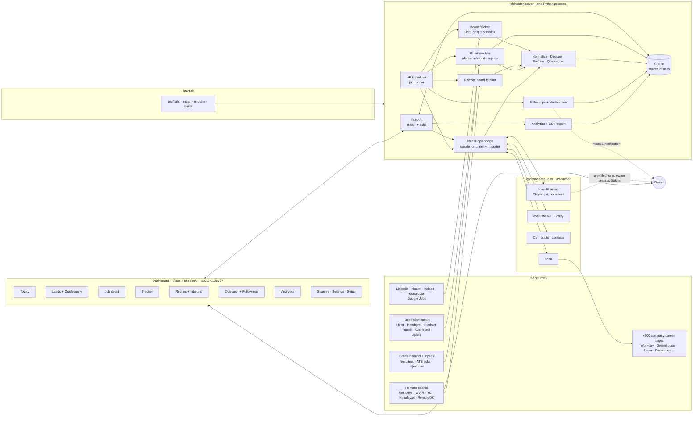
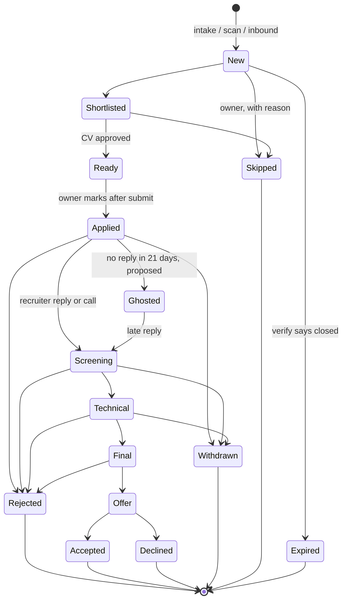
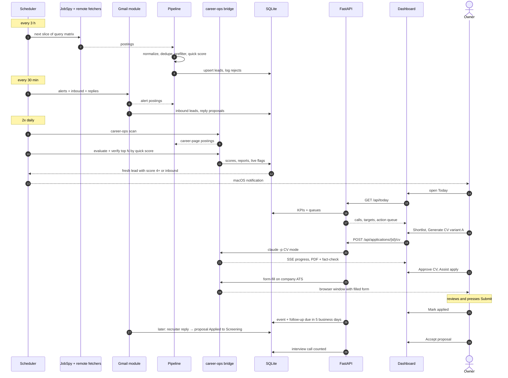
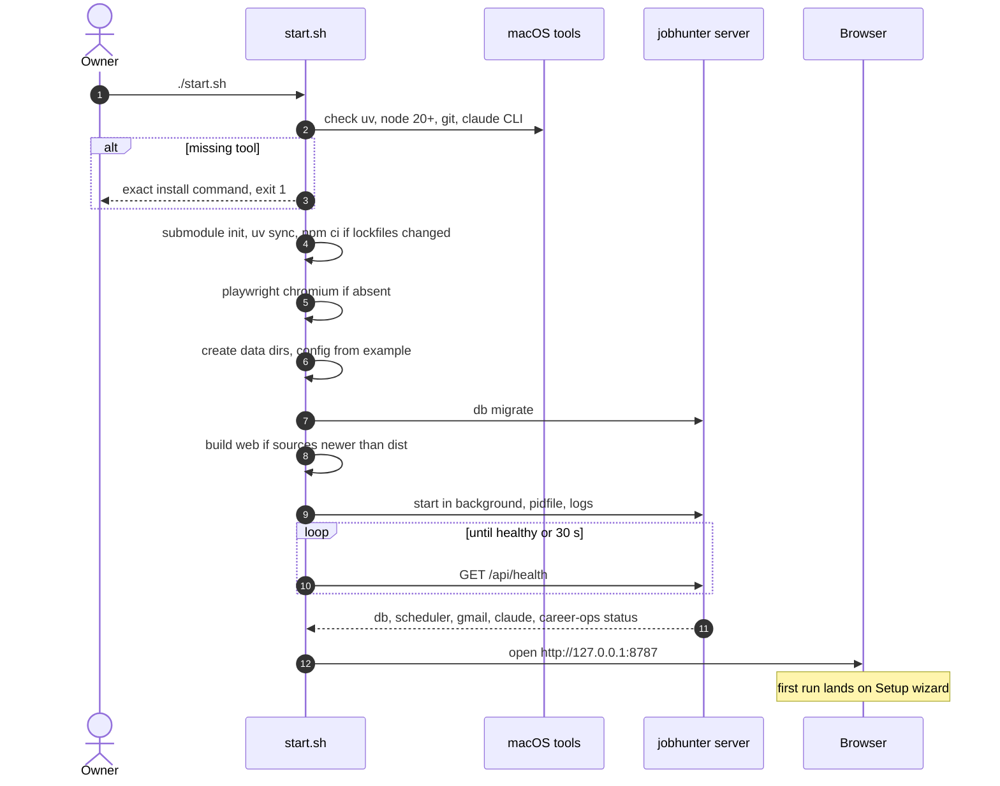
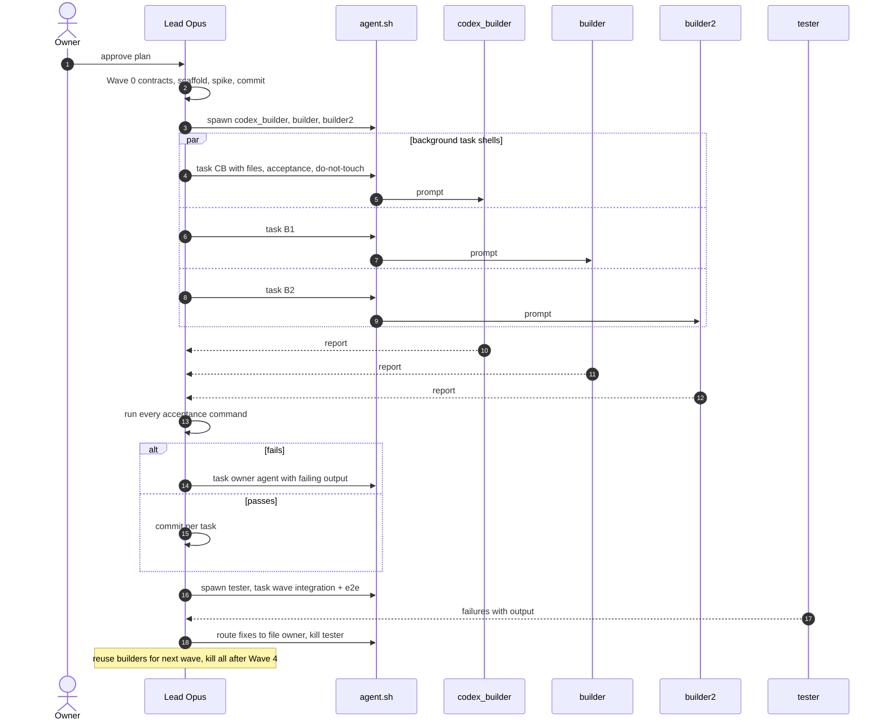
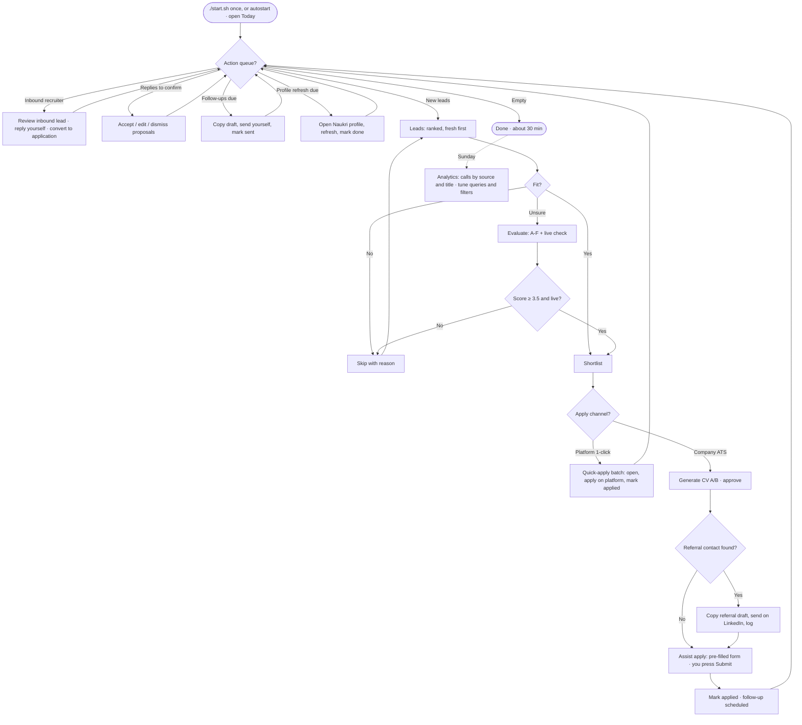

# job-hunter — implementation plan

Status: **v3.3, Wave 4: 4.1-4.3 done, 4.4 (owner day) next** (Waves 0-3 done, see section 13).

**Ultimate goal: as many interview calls as possible, as early as possible, with the least manual effort.** Every feature below is ranked by how much it moves that number.

Changes from v2: decisions D1-D6 recorded; sources widened from "email alerts" to **every reachable channel** (job boards, Google Jobs, ~300 career pages, remote boards, inbound recruiter platforms, referrals); interview-call levers added (freshness, quick-apply batching, form-fill assist, referrals, inbound capture); single `./start.sh`; Excel dropped (CSV export only); waves re-ordered so the dashboard is usable after Wave 2.

---

## 0. Summary: what's automated vs what you do

**Automated (no effort from you):**
- Searching LinkedIn, Naukri, Indeed, Glassdoor and Google Jobs every 3 h, across many title × city queries
- Scanning ~300 company career pages and remote job boards twice a day
- Reading job-alert and recruiter emails (Instahyre, Hirist, Cutshort, foundit, Wellfound, Uplers, LinkedIn, Naukri) every 30 min
- Removing duplicates, filtering out wrong city / seniority / stack / CTC below 10 LPA / stale posts
- Ranking every lead; deep A-F evaluation and "is it still live?" check for the top 10 per day (more on demand)
- Tailored CV per job (variant A or B) with a fact-check; cover-letter and referral drafts; finding referral contacts
- Pre-filling company application forms in a browser window (you review and press Submit)
- Tracker: every status change timestamped; replies and rejections detected from Gmail and proposed to you
- Follow-up reminders, desktop notifications for hot leads, funnel analytics, weekly insight

**Manual (only decisions and anything that sends or submits):**
- ~10 min: skim the ranked inbox, Shortlist or Skip
- ~15 min: approve CVs, press Submit on pre-filled forms or 1-click platform apply, send referral/follow-up messages (drafts are copy-ready)
- ~2 min: confirm proposed status changes (one click each)
- ~2 min/day: refresh your Naukri profile (dashboard reminds you and opens the page)
- One-time: create profiles on the inbound platforms, set up alerts, add a Gmail app password, label the golden set

**Never automated:** submitting applications, sending messages, logging into job sites as you (guardrails, section 8).

## 1. Recorded decisions

| # | Decision | Owner answer → design impact |
|---|---|---|
| D1 | JobSpy scraping | **Yes**: Naukri, Indeed, Glassdoor, Google Jobs, plus LinkedIn guest search (no login, so your account isn't involved), all rate-capped |
| D2 | Auto-evaluate top N daily | **Yes**: N = 10 by default, adjustable in Settings |
| D3 | Locations / CTC | **Chennai, Bengaluru, Remote** (India-remote + global-remote open to India). **CTC > 10 LPA**: drop only when the stated max is below 10 LPA; unknown CTC passes (most Indian posts hide it) |
| D4 | Desktop notifications | **Yes**: macOS notifications via `osascript` (no extra dependency) |
| D5 | Companion xlsx | **Ignored**; tracker export is CSV |
| D6 | **New**: Naukri profile auto-refresh (a logged-in bot edits your profile daily so it ranks higher in recruiter search) | **Decided 12 Nov: reminder-only.** Dashboard button opens the edit page (~2 min); `naukri_profile_bot` stays false. No logged-in bot |

## 2. Interview-call levers (why the design looks like this)

| Lever | Why it produces calls | Feature |
|---|---|---|
| **Coverage** | More relevant openings seen = more shots | Multi-source intake (section 3), query matrix, ~300-company career-page scan |
| **Freshness** | Early applicants (first 24-48 h) get far more recruiter views | Fetch every 3 h with `hours_old` windows; "Fresh" badge; notification for fresh + high-score leads |
| **Referrals** | Warm intros convert far better than cold applies (PDF: 10-15/week) | career-ops contact finder + drafts per shortlisted company; outreach tracker |
| **Inbound** | In India many calls come from recruiters searching Naukri / Instahyre / Hirist profiles | Profile checklist + freshness reminders; recruiter emails captured as top-priority "Inbound" leads |
| **Relevance** | Tailored, ATS-clean CVs pass screens | Variant A/B tailoring + fact-check |
| **Throughput** | More quality applies per minute | Quick-apply batch view (platform 1-click applies grouped); form-fill assist for company ATS forms |
| **Persistence** | Follow-ups revive silent applications | 5-7 business-day follow-up queue with drafts |
| **Learning** | Shift effort to channels that answer | Analytics: calls by source / title / variant / channel |

Volume target: the PDF says 30-40 applications/week. With quick-apply batching and pre-filled forms, the dashboard target defaults to **60/week + 15 referral requests**, editable. Quality gate stays: score ≥ 3.5 or owner override.

## 3. Sources: maximise job options

| # | Channel | Platforms | Ingestion | Cadence |
|---|---|---|---|---|
| 1 | Major boards | **LinkedIn** (guest search), **Naukri**, **Indeed India**, **Glassdoor India** | JobSpy | every 3 h, 07:00-23:00 |
| 2 | Aggregator | ~~Google Jobs~~ (JobSpy returns 0 rows, spike section 13; off by default) | JobSpy `google` | off |
| 3 | Company career pages | ~300 targets: Chennai/Bengaluru product companies, GCCs, fintech, SaaS, plus remote-first companies hiring in India (Workday, Greenhouse, Lever, Ashby, SuccessFactors, Darwinbox, Zoho Recruit, ...) | career-ops `scan.mjs` (public ATS APIs) | 2× daily |
| 4 | Remote boards | Remotive, WeWorkRemotely, Himalayas, RemoteOK (all career-ops providers, confirmed in spike) | career-ops scan | 2× daily |
| 5 | Login-only India platforms | **Hirist** (tech/Java-heavy), **Instahyre**, **Cutshort**, **foundit**, **Wellfound**, **Uplers** | Their job-alert emails → Gmail parsers | every 30 min |
| 6 | Inbound recruiters | Naukri recruiter mails, LinkedIn InMail notifications, Instahyre/Hirist/Cutshort interest mails, consultancy mails | Gmail inbound classifier → "Inbound" lead (top priority + notification) | every 30 min |
| 7 | Referrals | Employees at shortlisted companies (public info via career-ops contact finder) | Drafts; owner sends on LinkedIn | on shortlist |

**Query matrix** (editable in Settings): titles {Java Developer, Backend Engineer, Software Engineer Java, SDE 2, Spring Boot Developer, Microservices Engineer, Platform Engineer, Identity/IAM Engineer, Keycloak} × locations {Chennai, Bengaluru, Remote India} × sites. Queries rotate across runs so each site stays under its rate limits (LinkedIn 429s on bursts, Glassdoor at about 2 req/s) and full coverage completes daily. `results_wanted ≤ 50` per query, randomized delays, back off on 429.

**Target-company list builder** (`scripts/build_portals.py`): a seed list (career-ops `employers/` data + curated India list + LLM-suggested Chennai/Bengaluru Java employers) → ATS auto-detect → `data/portals.yml`. You can add or remove companies from the Settings page.

**Inbound profile checklist** (one-time, tracked on the dashboard): Naukri (headline, keywords, resume A, notice period, preferred cities), LinkedIn (Open-to-Work recruiters-only, headline from the PDF), Instahyre, Hirist, Cutshort, Wellfound, Uplers, foundit; remote: Turing, Arc. *Wave 0 verifies each is still active in Nov 2026.*

## 4. Prefilter rules (India, recall-first)

| Rule | Pass | Drop | Unknown |
|---|---|---|---|
| Location | Chennai, Bengaluru/Bangalore, Remote (India / worldwide / APAC), Pan-India, hybrid in those cities | other cities only; "US/EU only" remote | pass + tag |
| Experience | range overlaps 2-4 yrs (e.g. "2-5", "3+", SDE I/II) | min ≥ 6, Staff/Principal, intern, 0-1 fresher | pass |
| CTC | max ≥ 10 LPA (monthly ×12; USD at a configurable rate) | stated max < 10 LPA | pass + "CTC unknown" |
| Stack | Java/Spring/Quarkus/backend/platform/IAM signals | clear non-fit (pure frontend, mobile, PHP-only, sales, QA-only) | pass |
| Freshness | ≤ 14 days | > 30 days or verify says closed | pass |

Every drop is logged with its reason, shown in Analytics → reject audit, and restorable. Gate: **recall ≥ 95%** on the golden set's "apply" labels.

Ranking: a deterministic **quick score** (CV keyword overlap + role family P1/P2 + freshness + source weight + inbound boost) orders every lead. The top N then get the career-ops A-F LLM evaluation.

## 5. Open-source building blocks

| Need | Adopt |
|---|---|
| Scan, evaluate, verify live, tailor CV, drafts, contact finder, form-fill assist | **[career-ops](https://github.com/santifer/career-ops)** (MIT), vendored submodule, untouched, driven headless via `claude -p` |
| Job boards | **[JobSpy](https://github.com/speedyapply/JobSpy)** (`python-jobspy`, MIT) |
| Gmail read | **imap-tools** + app password in macOS Keychain (`keyring`) |
| Parsing / dedupe | **selectolax**, **RapidFuzz** |
| Backend | **FastAPI**, **APScheduler**, **SQLite** + **SQLModel** |
| Dashboard | **React + Vite + TS**, **shadcn/ui**, **TanStack Query/Table**, **Recharts**, **dnd-kit**, **react-pdf** |
| Contract / mocks | **openapi-typescript**, **MSW** |
| Tests | **pytest**, **Vitest**, **Playwright**, **schemathesis** |
| Notifications | macOS `osascript` |
| Autostart | macOS launchd (plist generated by `start.sh`) |

## 6. Architecture

### 6.1 Component diagram



Design rules:
- **One server process** hosts the API, the built dashboard, the scheduler and the background runs. `./start.sh` is the only command you ever type (section 10).
- **SQLite is the single source of truth.** career-ops writes markdown and PDFs into `data/careerops/` and the bridge imports them; its own tracker points at a scratch file.
- Long operations are rows in `runs`, streamed to the UI over SSE. `claude -p` concurrency is capped at 2 to protect the Pro quota.
- Localhost only. Secrets live in the Keychain, entered once through the dashboard Setup page.

### 6.2 Data model (lead-owned contract)

| Table | Key fields |
|---|---|
| `leads` | source, source_ref, canonical_url, apply_url, **apply_channel** (platform-quick / company-ATS / email), company, title, location, work_mode, exp_min/max, ctc_min/max, posted_at, found_at, jd_text, role_family, prefilter_pass/reasons, quick_score, is_inbound, dedupe_group |
| `evaluations` | lead_id, score, grade, report_path, is_live, live_verified_at, run_id |
| `applications` | lead_id, status, resume_variant, cv_pdf_path, cv_approved, applied_at, next_follow_up_at, referral_contact, recruiter, notes, rejected_at_stage |
| `events` | application_id, from/to status, at, actor (owner/system/proposal), note |
| `proposals` | type (status_change / ghosted / inbound / needs_eyes), payload, evidence, confidence, state |
| `outreach` | application_id, kind (referral / follow-up / recruiter-reply), contact, draft, sent_at |
| `profiles` | platform, last_refreshed_at, checklist state |
| `runs`, `source_health`, `settings` | operational |

### 6.3 Tracker states



`Rejected` stores `rejected_at_stage`. **"Interview call" = any transition into Screening**, and that's the headline KPI on Today and Analytics.

### 6.4 Dashboard pages

Restructured 23 Nov 2026 around the daily loop (review → apply → confirm mail → follow up). The sidebar groups pages by
what the owner is doing; anything that is configuration or diagnostics lives under Settings. Routes kept their paths.

| Nav group | Page (route) | Shows | Actions |
|---|---|---|---|
| — | **Home** (`/`) | Week strip: applied vs target, referrals vs target, interview calls vs last week; **To do** list, one row per kind of work in priority order (recruiters, email updates, follow-ups, CVs to approve, shortlisted jobs to apply to, profile refresh); fresh matches; a banner only when a service is down | Jump to the page that handles a task · Shortlist / Skip · Open Naukri + Mark done |
| Daily work | **Jobs** (`/leads`) | Tabs: **To review** (New), **To apply** (Shortlisted + Ready on every channel, with the next step per job), **All jobs** (any status, auto-filtered jobs on request). Search + sort up front, other filters folded behind one button | Shortlist · Skip · Evaluate · Verify · bulk actions · Prepare CV · Apply on site · Mark applied · Find new jobs |
| Daily work | **Inbox** (`/replies`) | Recruiters reaching out, application updates (status change / ghosted), "please check" mails; cleaned previews (entities decoded, URLs and footers dropped) | Add to my jobs · Mark *status* · Different status · Ignore · for unsure mails: change the application status directly |
| Daily work | **Follow-ups** (`/outreach`) | Due now (most overdue first, "Overdue by N days"), referral requests, sent; messages folded until opened | Copy message · Mark sent · Edit · Remind me in 1/3/7 days |
| Progress | **Applications** (`/tracker`) | Summary (waiting, interviewing, offers, closed); board from Applied → Offer + collapsed Closed; pointer to Jobs › To apply for not-yet-applied ones; table view of everything | Drag or Move to… (asks for reject stage) · CSV export |
| Progress | **Insights** (`/analytics`) | Applied, calls, call rate, typical reply time; suggestions; funnel; calls by source / channel / title / variant; weekly pace | Date range |
| — | **Job detail** (`/jobs/:id`) | Header facts; AI evaluation / JD tabs; **next-step card** by status (New: shortlist or skip; Shortlisted/Ready: 4 apply steps; Applied+: status picker); tailored CV, contacts, notes, timeline; activity log folded unless a task is running | as before; nothing submits or sends |
| bottom | **Settings** (`/settings?tab=`) | Tabs: Job search (query matrix, automatic filters, what the filters removed, grouped by rule with named examples), Companies, Goals & automation (targets, AI evaluation, schedules, follow-ups), Profiles, CVs & Gmail, System (service health, sources, run logs) | Edit · toggle · restore · run now |

## 7. Diagrams: runtime, startup, build, user workflow

### 7.1 Daily runtime sequence



### 7.2 Startup sequence (`./start.sh`)



### 7.3 Multi-agent build orchestration



### 7.4 User workflow (daily, dashboard only)



## 8. Guardrails

1. **No auto-submit, no auto-send.** "Assist apply" fills fields and stops; you press Submit. Drafts are copy-only. No code path sends email or messages.
2. **No logging into job sites as you.** JobSpy uses public guest endpoints. The Naukri profile bot is off unless D6 says otherwise.
3. **Gmail read-only** in code.
4. **Rate caps** on every scraper; back off on 429; a site that keeps failing is auto-paused and flagged in source health.
5. **Personal data never committed**: `data/`, `.env`, `*.sqlite` are gitignored; secrets in the Keychain; server on 127.0.0.1.
6. **Never drop silently**: rejects stay auditable and restorable.
7. **Resume truthfulness**: career-ops fact-check always on; nothing is Ready without your approval.

## 9. Accuracy gates

- Golden set (60-100 postings you label in Wave 0): prefilter recall ≥ 95%, dedupe precision ≥ 99%.
- Email parsers: ≥ 3 real sanitized fixtures per sender; every job card extracted.
- Reply/inbound templates: precision ≥ 98% on fixtures. Anything uncertain becomes a proposal, never a direct status change.
- JobSpy fetchers: recorded-response fixtures per site, so tests don't hit the network.

## 10. Single startup script: `./start.sh`

One bash file at the repo root, idempotent, macOS. It's the only command the owner runs. (`scripts/up.sh` stays as the agent-workspace launcher for development.)

| Command | Does |
|---|---|
| `./start.sh` (= `up`) | preflight → install/update deps (only if lockfiles changed: hash stamps in `data/run/`) → submodule init → Playwright chromium if absent → create `data/` dirs + config from example → `jobhunter db migrate` → build `web/` if sources are newer than `dist/` → start the server in the background (pidfile `data/run/server.pid`, logs `data/logs/server.log`) → poll `/api/health` up to 30 s → open the browser |
| `./start.sh stop` / `restart` | graceful stop via pidfile (SIGTERM, then SIGKILL after 10 s) |
| `./start.sh status` | pid, uptime, and the health JSON summarized (db, scheduler, last run per source, Gmail, claude CLI, career-ops) |
| `./start.sh logs [-f]` | tail the server log |
| `./start.sh doctor` | preflight only, with exact fix commands (`brew install uv`, `claude login`, ...) |
| `./start.sh autostart on\|off` | writes/removes `~/Library/LaunchAgents/com.jobhunter.server.plist` (RunAtLoad, KeepAlive) pointing at `./start.sh foreground` |
| `./start.sh dev` | for agents: `uvicorn --reload` + `vite dev` with API proxy, both in the foreground |

Services it manages: **one** server process (FastAPI + scheduler + dashboard static files). SQLite needs no daemon. Playwright and `claude -p` start on demand. No Docker.

Acceptance: on a fresh clone, `./start.sh` → dashboard healthy; a second run completes in < 10 s with no reinstall; `stop` leaves no orphan processes; `doctor` exits non-zero and prints a fix when `claude` is absent from PATH.

## 11. Repo layout and file ownership

```
start.sh                               lead (skeleton W0, final W4)
vendor/career-ops/                     submodule · nobody edits
data/                                  gitignored runtime
config/jobhunter.example.yml           lead
contracts/openapi.json                 lead
src/jobhunter/models.py, schemas.py, settings.py, paths.py, db/**   lead (contract)
src/jobhunter/intake/boards.py         codex_builder W1 (remote boards come from career-ops scan)
scripts/build_portals.py               codex_builder W1
src/jobhunter/pipeline/**              builder W1
src/jobhunter/careerops/**             codex_builder W2
src/jobhunter/api/**, jobs/**          builder W2
src/jobhunter/gmail/**                 codex_builder W3 (alerts, inbound, replies)
src/jobhunter/followups/**, notify/**, analytics/**   builder W3 (+ api/**, jobs/** wiring)
web/src/api/**, web/src/mocks/**       lead
web/src/app/**, pages/today, pages/leads                         builder2 W1
web/src/pages/job, pages/tracker, pages/replies                  builder2 W2
web/src/pages/analytics, outreach, settings (incl. Setup)        builder2 W3
tests/integration/**, web/e2e/**       tester (per wave)
src/jobhunter/cli.py                   lead W4
```

## 12. Delivery: multi-agent waves

Roles from `agents.conf` (unchanged). At most 3 builders + 1 tester at a time. Each task prompt names its files, acceptance command and do-not-touch list. The lead runs every acceptance command, then commits.

**Parallelism:** `agent.sh task` blocks for up to 10 min, so the lead fires the three tasks as background shells and collects with `read`/`list`. Over-cap tasks keep running and the lead polls. Builders are reused across waves, the tester is spawned and killed per wave, and everything is killed after Wave 4.

**Do not touch (all agents, all waves):** `models.py`, `schemas.py`, `settings.py`, `paths.py`, `db/**`, `contracts/**`, `web/src/api/**`, `web/src/mocks/**`, `vendor/**`, `data/**`, `start.sh`, other agents' files.

### Wave 0: foundation (lead + owner)
| # | Task | Acceptance |
|---|---|---|
| 0.1 | Owner: confirm D6; CV text; Gmail app password; create profiles + alerts on the section 3 platforms; export ≥ 3 `.eml` per alert sender + a few recruiter/ATS mails; label the golden set | inputs present |
| 0.2 | `.gitignore`, `pyproject.toml`, `models.py`, `db/`, API stubs → `contracts/openapi.json`, `config/jobhunter.example.yml` | `uv run python -m jobhunter.api.dump_openapi` diff-clean |
| 0.3 | `web/` scaffold (Vite, TS, Tailwind, shadcn), generated client, MSW fixtures | `cd web && npm run build` |
| 0.4 | career-ops submodule + init into `data/careerops/`; Playwright chromium | career-ops self-check passes |
| 0.5 | `start.sh` skeleton (`doctor`, `dev`) | `./start.sh doctor` |
| 0.6 | **Spike** → section 13: headless `claude -p` for evaluate / verify / CV / form-fill / contacts; JobSpy smoke per site from India (LinkedIn guest, Naukri, Google); career-ops support for Himalayas/RemoteOK; platform-active check | one lead end to end headless; JobSpy returns India rows per site |

### Wave 1: discovery engine + UI shell (dashboard on mocks)
| Agent | Task | Files | Acceptance |
|---|---|---|---|
| codex_builder | JobSpy query-matrix fetcher (rotation, caps, backoff, auto-pause), portals builder (seed → ATS detect → `portals.yml`, incl. remote boards via career-ops providers) | `intake/boards.py`, `scripts/build_portals.py`, `tests/test_boards.py`, `tests/fixtures/boards/**` | `uv run pytest tests/test_boards.py` (recorded fixtures) |
| builder | normalize, dedupe, India prefilter (section 4), quick score, store, golden eval | `pipeline/**`, `tests/test_pipeline.py`, `scripts/eval_golden.py` | `uv run pytest tests/test_pipeline.py && uv run python scripts/eval_golden.py` (recall ≥ .95, dedupe prec ≥ .99) |
| builder2 | App shell (nav, light/dark), **Today**, **Leads** + Quick-apply view on MSW | `web/src/app/**`, `pages/today/**`, `pages/leads/**`, `web/src/components/**` | `cd web && npm run build && npm run test` |
| tester | fixtures → pipeline → DB integration; Playwright smoke on mocks | `tests/integration/**`, `web/e2e/**` | `uv run pytest tests/integration && npx playwright test` |

### Wave 2: evaluation + API + tracker → **first usable dashboard with real data**

Revised 12 Nov (v3.1): 4 builders in parallel (fresh agents), contract-first. The lead wrote the interface stubs
`src/jobhunter/careerops/__init__.py`, `src/jobhunter/jobs/runner.py`, `src/jobhunter/jobs/scheduler.py`
(signatures + docstrings are the contract; owners implement bodies, never change signatures). `./start.sh up`
moves from the lead to `codex_jobs` (owner asked the lead to supervise only).

| Agent (role) | Task | Files | Acceptance |
|---|---|---|---|
| `cops` (codex_builder) | career-ops bridge: scan import, evaluate (claude -p read-only, Machine Summary → Evaluation), verify (liveness), CV + fact-check → PDF, assist-apply (headed, never submits), contacts + referral drafts, report_md | `careerops/**`, `tests/test_careerops.py`, `tests/fixtures/careerops/**` | `uv run pytest tests/test_careerops.py` (subprocess faked via `JOBHUNTER_CLAUDE_BIN`/`JOBHUNTER_NODE_BIN`) |
| `jobs` (codex_builder) | run engine (pools, logs, cancel, SSE events, boot recovery), APScheduler (boards window, scan times, auto-evaluate top N), services health; `start.sh` up/stop/restart/status/logs/foreground | `jobs/**` (bodies only), `start.sh`, `tests/test_jobs.py` | `uv run pytest tests/test_jobs.py && ./start.sh up && ./start.sh status && ./start.sh stop` |
| `api` (builder) | every route in `api/**` per contract (leads, applications + transitions, proposals/outreach CRUD, runs + SSE, today, basic analytics, sources, settings, secrets → Keychain, profiles, setup, health), lifespan starts the scheduler | `api/**` (not `dump_openapi.py`, `_stub.py`), `src/jobhunter/secrets.py`, `tests/test_api.py` | `uv run pytest tests/test_api.py && uv run python -m jobhunter.api.dump_openapi --check` |
| `web` (builder2) | **Job detail**, **Tracker** (kanban + table + CSV), **Replies & Inbound**, minimal **Settings** (N, concurrency, query matrix, targets, source toggles, run intake now) | `web/src/pages/{job,tracker,replies,settings}/**`, `web/src/app/**`, `web/src/components/**`, `web/package.json` | `cd web && npm run build && npm run test` |
| `tester` (codex, after the 4 land) | real-server e2e with fake claude: lead → shortlist → evaluate → CV → approve → applied → timeline; Playwright on the real API | `tests/integration/**`, `web/e2e/**`, `tests/fakes/**` | `uv run pytest tests/integration && cd web && npx playwright test` |

Business rules fixed for Wave 2 (API):
- A lead without an application has status New. Shortlist / Skip create the Application (Event actor=owner).
- Transition to Applied from New/Shortlisted/Ready walks the main line (New→Shortlisted→Ready→Applied), one Event per step (auto steps actor=system, note "quick apply"); sets `applied_at`, `next_follow_up_at` = +5 weekdays (holidays in Wave 3).
- `cv_approved=true` on a Shortlisted application moves it to Ready (Event).
- Rejected requires `rejected_at_stage`; illegal transitions → 409.
- Manual lead → `pipeline.ingest` with Source.manual and `restored=True` (owner wants it, never dropped).

After Wave 2 the lead runs real intake + one real evaluate, then writes `docs/setup.md` (owner setup to run at full potential, incl. `.eml` export guide).

### Wave 3: Gmail + feedback loop + insight

Revised 12 Nov (v3.2), contract-first like Wave 2. Most analytics routes already landed in Wave 2 (`api/insight.py`),
so the analytics task shrinks to rule-based insights. `export/**` dropped (applications CSV exists). The ghosted
rule moves from Gmail to follow-ups (it needs no mail). Lead wrote the stubs: `gmail/__init__.py`,
`followups/__init__.py`, `notify/__init__.py`, `analytics/__init__.py` (signatures + docstrings are the contract),
schemas `Insight`, `FollowupRules` (`Settings.followups`), `Company*`, `CheckResult`, stub routes
`/api/companies*`, `/api/setup/gmail-test`, `/api/analytics/insights`, MSW mocks for all of them.

| Agent (role) | Task | Files | Acceptance |
|---|---|---|---|
| `gmail` (codex_builder) | read-only IMAP client + cursor; classifier (alert / inbound / reply / other); alert parsers for the 8 senders; inbound → lead + inbound proposal; reply templates (ack, rejection, interview, assessment) → status_change / needs_eyes proposals; `check_login`, `health` | `gmail/**`, `tests/test_gmail.py`, `tests/fixtures/emails/**` (sanitized copies of `data/emails/raw`, plus synthetic ones for senders with no sample) | `uv run pytest tests/test_gmail.py` (all cards parsed; reply precision ≥ .98 on fixtures; no Application/Event writes) |
| `ops` (builder) | follow-ups (IST business days + holidays, drafts, second follow-up), ghosted proposals, notifications (osascript, dedupe, quiet hours), insights; routes for companies (portals.yml), gmail-test, insights; `add_weekdays` → business days; runner dispatch for `intake_gmail` + `followups`, notify after intake, scheduler jobs (gmail every N min, followups hourly 08-21), gmail health row | `followups/**`, `notify/**`, `analytics/**`, `api/**` (not `dump_openapi.py`, `_stub.py`), `jobs/**` (bodies, plus the two dispatch branches), `tests/test_followups.py`, `tests/test_notify.py`, `tests/test_analytics.py`, `tests/test_api_*.py`, `tests/test_jobs.py` | `uv run pytest tests/test_followups.py tests/test_notify.py tests/test_analytics.py tests/test_api_*.py tests/test_jobs.py && uv run python -m jobhunter.api.dump_openapi --check` |
| `web` (builder2) | **Analytics** (funnel, calls by source/channel/title/variant, weekly vs targets, response time, insights, reject audit with restore), **Outreach & Follow-ups** (due follow-ups, referral drafts, sent log; copy / mark sent / snooze), **Settings** extended: Setup wizard (CV A/B upload, Gmail secrets + Test, status checklist), companies list, prefilter rules, schedules, follow-up rules, run logs | `web/src/pages/{analytics,outreach,settings}/**`, `web/src/app/**`, `web/src/components/**` | `cd web && npm run build && npm run test` |
| `tester` (after the 3 land) | inbound mail → lead → notification; reply → proposal → accept → calls KPI; follow-up due → outreach; Playwright for Analytics/Outreach/Setup on mocks and real server | `tests/integration/**`, `web/e2e/**`, `tests/fakes/**` | `uv run pytest && cd web && npx playwright test` |

Open on the owner side: real alert samples exist for LinkedIn (3), Instahyre (2), Cutshort (1), Wellfound (1);
none yet for Naukri, Hirist, foundit, Uplers, so those parsers start from synthetic fixtures and are marked
unverified until real mail arrives (section 9 gate: ≥ 3 real per sender).

### Wave 4: integration + ops

Revised 12 Nov (v3.3). Findings from the first real day that reshape 4.2: every `careerops_scan` run timed out
at 600 s (0 career-page leads; Workday tenants like VMware return 400+ worldwide postings with per-posting
detail fetches, all-or-nothing on timeout), and 153 of 177 `portals.yml` companies are websearch fallbacks
that the API scan skips ("no public API provider"). One CV run failed on a Claude 5-hour usage limit, surfaced
only as "exit status 1". Headless `claude -p` also loads the owner's user hooks/plugins (a style hook got
injected into the CV session): drafts must run without user settings.

| Agent (role) | Task | Files | Acceptance |
|---|---|---|---|
| `scan` (codex_builder) | 4.2a scan that finishes: India/remote location pre-filter in node before output (keep India cities, "India", remote/anywhere/APAC, empty), per-entry timeout, concurrency 8, overall deadline that returns partial results instead of failing, bridge timeout for scan 1500 s; claude runs isolated from user settings (no user hooks/plugins, auth still works); usage-limit events → clear `BridgeError` with reset time (IST) | `careerops/**`, `tests/test_careerops.py`, `tests/fixtures/careerops/**` | `uv run pytest tests/test_careerops.py` + real scan run < 15 min with careerops_scan leads > 0 |
| `portals` (codex_builder) | 4.2b ATS resolver: for each websearch entry probe careers page links + known ATS slugs (greenhouse, lever, ashby, workable, smartrecruiters, recruitee, darwinbox, keka, zoho-recruit, turbohire, workday) and write `provider` + API url only when a live probe returns postings; grow the seed to ~300 Chennai/Bengaluru/remote-India product companies that hire Java/backend | `scripts/build_portals.py`, `config/seed_companies.yml`, `tests/test_build_portals.py`, `tests/fixtures/portals/**` | `uv run pytest tests/test_build_portals.py`; real build → ≥ 280 companies, ≥ 180 API-resolvable (career-ops `resolveProvider`), doctor green |
| `ops` (builder) | 4.1 `cli.py` (`jobhunter db migrate`, `run <kind> [--wait]`, `health`, `doctor-json`), final `start.sh` (`autostart on\|off` launchd plist at `~/Library/LaunchAgents/com.jobhunter.server.plist` → `./start.sh foreground`, RunAtLoad + KeepAlive, PATH baked in; migrate via cli; usage text) | `src/jobhunter/cli.py`, `start.sh`, `tests/test_cli.py`, `tests/test_start_sh.py` | `uv run pytest tests/test_cli.py tests/test_start_sh.py` + section 10 acceptance (2nd `up` < 10 s, `stop` no orphans, `doctor` exit 1 without claude) |
| lead | query matrix tuning from real data (drop reasons, score by source), real scan + intake re-run after `scan`/`portals` land | `config/jobhunter.example.yml`, `data/config.yml` | scan returns Chennai/Bengaluru/remote roles |
| `tester` (after the 3 land) | 4.3 full pass: all pytest, golden eval, vitest, Playwright mock + real server; regression tests for scan partial results and usage-limit error | `tests/integration/**`, `web/e2e/**`, `tests/fakes/**` | `uv run pytest && uv run python scripts/eval_golden.py && cd web && npm run test && npx playwright test` |
| owner | 4.4 one real day, dashboard only | — | owner completes section 7.4 without a terminal |

### Timeline (target)
| When | Milestone |
|---|---|
| Day 1 (13 Nov) | Wave 0. Owner applies manually from native alerts meanwhile |
| Day 2-3 | Wave 1: discovery engine running |
| Day 3-4 | Wave 2: **daily use of the dashboard starts** |
| Day 5-6 | Wave 3: inbound, replies, follow-ups, analytics |
| Day 7 | Wave 4: hardened, autostart |
| After | No new features; tune queries/filters weekly from "calls by source" |

## 13. Spike notes (filled in Wave 0, 12 Nov 2026)

**Toolchain:** Python 3.13 (uv 0.13), Node 22.23, Claude CLI 2.1.287, codex 0.167. Web pins **TypeScript 5.9** (openapi-typescript needs the TS 5 JS API; TS 7 native breaks it). MSW is **v3** (`onUnhandledFrame`, not `onUnhandledRequest`). openapi-fetch client late-binds `fetch` so MSW can patch it.

**JobSpy 1.4.1 smoke from India** (1 query, 5 results, `hours_old=72`):

| Site | Result | Notes |
|---|---|---|
| LinkedIn (guest) | ✅ 5 rows, 0.8 s | relevant Chennai Java roles; descriptions only with `linkedin_fetch_description=True` (~3 s per 2 rows) |
| Naukri | ✅ 5 rows, 0.9 s | best metadata: `experience_range`, `skills`, salary INR/yearly, `work_from_home_type`; `fetch_description=True` gives ~350-char snippets |
| Indeed India | ✅ 5 rows, 2.8 s | descriptions included; location granularity is state ("TN, India") → prefilter must map states |
| Glassdoor India | ✅ 5 rows, 0.9 s | salaries sometimes **monthly** INR → ×12 rule needed |
| Google Jobs | ❌ 0 rows, 3 phrasings | JobSpy's Google scraper returns nothing. **Removed from default `query_matrix.sites`**; coverage it gave (foundit, Shine, company pages) comes from career-ops scan + Gmail alerts. Revisit if JobSpy fixes it |

**career-ops (v1.40.0, submodule):**
- Data root via env `CAREER_OPS_DATA_DIR=data/careerops` → vendor stays untouched (set in `start.sh`).
- Already has providers for **Himalayas, RemoteOK, Remotive, WeWorkRemotely**, plus Indian ATSs **Darwinbox, Keka, TurboHire, Zoho Recruit**, and Workday/Greenhouse/Lever/Ashby/SuccessFactors/SmartRecruiters. → `intake/remote_boards.py` dropped from Wave 1.
- Evaluation is an **A-H report with a 1-5 score** (plan said A-F/0-5). `evaluations.score` stores 1-5; `grade` stores its letter. Quality gate 3.5 stays.
- Headless pattern exists (`docs/AUTOMATION.md`, `scripts/followup-sweep.sh`): `claude -p` in `dontAsk` mode, explicit tool allowlist, `--add-dir` data root, job-posting text treated as untrusted. The bridge (Wave 2) copies this pattern.
- Install needed an owner-approved allow rule (`.claude/settings.local.json`) because the auto-mode classifier blocks running external code by default.
- **Bridge design (from career-ops' own web runner, `web/src/lib/run-prompts.mjs` + `claude-invocation.mjs`):** evaluate runs with a *read-only* scope (`Read,WebFetch,WebSearch,Glob,Grep`; `Write,Edit,MultiEdit,NotebookEdit,Bash,Task` denied; `--strict-mcp-config`), cwd = data root, `--add-dir vendor/career-ops`, JD passed pre-fetched (`prefetchedJd`), report returned inline in a `<<report-md>>` envelope; the harness persists it. Our bridge imports `buildPrompt` + `claudeCliArgs` from career-ops instead of hand-writing prompts.

**Headless evaluate, end to end (12 Nov 2026):** real LinkedIn posting (Netcomm IT Solutions, "Backend Developer (Java + Spring Boot)", Chennai) fetched by JobSpy with description → career-ops `buildPrompt({kind:"evaluate", prefetchedJd})` + `claudeCliArgs` → `claude -p` (cwd `data/careerops`, `--add-dir vendor/career-ops`). Result: **success, 216 s, 20 turns, 3.7/5, archetype P1, legitimacy "Proceed with Caution"**; it read only cv.md/profile/_profile + mode files and ran 3 web searches; no writes. Output = `<<report-md>> … <</report-md>>` with sections A-G, verdict, score evidence, cover-letter draft, archived JD and a YAML **Machine Summary** (`score`, `legitimacy_tier`, `archetype`, ...) → the importer parses that block. Copy kept in `data/spike/`.

**Cost warning:** one full evaluate ≈ **$1.32 API-equivalent** (88 K cache-write, 557 K cache-read, 22 K output tokens) and ~3.5 min. Top-10/day ≈ 13 such runs/day on the owner's Claude subscription quota. Mitigations for Wave 2 bridge: keep `claude_concurrency=2`; evaluate only leads above a quick-score floor; try career-ops' focused scope (`evaluation_scope: focused`, `evaluation-options.mjs`) or its two-pass triage (`modes/_brief.md`) for a cheaper first pass; owner can lower `auto_evaluate_top_n` in Settings.

**Platform check (HTTP, 12 Nov 2026):** Naukri, LinkedIn, Hirist, Cutshort, Wellfound, Uplers, Turing, Arc, Himalayas, RemoteOK, Remotive all 200. Instahyre, foundit, WWR, Glassdoor, Indeed answer 403 and YC 406 to curl: bot walls on the homepage, not dead sites (Indeed/Glassdoor scraped fine via JobSpy). All section 3 platforms are treated as active.

**Wave 0 status:**

| # | State |
|---|---|
| 0.1 | ◐ D6 decided (reminder-only); CV received → `data/careerops/cv.md` (master), `data/cv/cv_a.md` (variant A, same facts reordered), `data/cv/cv_b.md` (variant B, adds AI Developer Tooling verified from the owner's own repos), career-ops `profile.yml` + `modes/_profile.md` (expected CTC, notice period). Pending from owner: review of variant B wording, alert accounts + `.eml` exports, golden labels. Gmail app password: owner enters in Setup page (Wave 3) |
| 0.2 | ✅ `uv run python -m jobhunter.api.dump_openapi --check`, `uv run pytest` (6 pass) |
| 0.3 | ✅ `cd web && npm run build && npm run test` (3 pass on MSW) |
| 0.4 | ✅ `npm install --no-package-lock` (career-ops ships no lockfile; submodule tree stays clean), `doctor.mjs` with `CAREER_OPS_DATA_DIR=data/careerops`: 0 errors, only `portals.yml` missing (Wave 1 `build_portals.py`) |
| 0.5 | ✅ `./start.sh doctor` (exit 1 without `claude`), `./start.sh dev` serves API + Vite proxy |
| 0.6 | ✅ JobSpy (4/5 sites), platforms, career-ops coverage, **headless evaluate end to end** (below) |

**Wave 1 status (12 Nov 2026): ✅ done**

| Task | Result |
|---|---|
| codex_builder | `intake/boards.py` (JobSpy, daily matrix cursor, per-site health), `config/seed_companies.yml`, `scripts/build_portals.py` → `data/careerops/portals.yml` (173 companies, 4 boards; career-ops doctor all green); 55 tests |
| builder | `pipeline/**` (normalize, CTC/exp/location parse, dedupe, prefilter, quick score, store); golden seed 87 postings: prefilter recall on apply 1.000, dedupe precision 1.000; 87 tests |
| builder2 | app shell, Today, Leads (+ Quick apply tab) on MSW mocks; table fits at ≥1280 px, cards on mobile, lazy routes; 28 vitest |
| tester | `tests/integration/**` (fetch → pipeline → DB, idempotency, site-failure isolation, golden, API smoke) 9 tests; Playwright smoke on mocks 8 tests |

Totals: `uv run pytest` 157 passed, vitest 28, Playwright 8. Golden seed labels are builder-made; owner labels in `data/golden/*.jsonl` still wanted.

**Wave 2 status (12 Nov 2026): ✅ built, one tuning task open**

| Task | Result |
|---|---|
| cops | career-ops bridge: scan, evaluate, verify, CV + fact-check, assist apply (non-GET requests blocked + submit events cancelled while filling), contacts; 41 tests. **Real evaluate smoke: Wayfair SE II Java Backend → 3.8/5, 196 s, $1.26 API-equivalent** |
| jobs | run engine, scheduler, auto-evaluate, `start.sh up/stop/restart/status/logs/foreground`; 33 tests; 2nd `up` 0.6 s, no orphans |
| api | all routes per contract, Keychain secrets, schemathesis; fixed malformed-URL crash in pipeline |
| web | Job detail, Tracker, Replies, Settings; 72 vitest |
| tester | real-API flow 14 integration tests; Playwright real-server 2/2, mock 8/8 |

Totals: `uv run pytest` 335 passed. Real board fetch: 358 fetched, 336 new, 120 duplicates, 126 dropped.
Pipeline tuning (score spread at the top, city-in-title drop) landed in 1a7fd32.

**Wave 3 status (12 Nov 2026): ✅ done**

| Task | Result |
|---|---|
| gmail | read-only IMAP (readonly folder, no initial writable select, `mark_seen=False`), UID cursor, classifier, alert parsers for 9 senders (Indeed added after the real-mailbox run), inbound + reply proposals, conversation dedupe, newsletter/promo filter, decoded subjects; 79 tests, 61 sanitized fixtures; reply + inbound precision 100% on fixtures |
| ops | follow-ups (IST business days + 2026-27 holidays, drafts, second follow-up), ghosted proposals, osascript notifications (dedupe, quiet hours), rule-based insights, companies CRUD on `portals.yml`, gmail-test, gmail + followups runs scheduled |
| web | Analytics, Outreach & Follow-ups, Settings (setup wizard, companies, prefilter, schedules, follow-up rules, run logs); 98 vitest |
| tester | `test_wave3_flow.py` (inbound → convert, alerts idempotent, rejection/interview proposals → calls KPI, follow-ups, ghosted, companies, gmail-test); Playwright mock 14, real 3 |

Totals: `uv run pytest` 650 passed, vitest 98, Playwright 14 + 3 real.
**Real mailbox run (390 mails):** first pass gave 7 inbound + 4 needs-eyes, only 1 right (Indeed digests, newsletters, promos). After the fix: 534 job cards from 36 alerts (LinkedIn 150, Indeed 374, Cutshort 10), 1 inbound (a LinkedIn InMail, correct), 1 needs-eyes (a rejection from a company with no application, correct), re-run adds nothing, no Application/Event writes.
Open: no real alerts yet from Naukri, Hirist, foundit, Uplers, Instahyre in the last 60 days (those parsers rely on synthetic fixtures); the owner's Indeed alerts are fresher/intern searches (307 of 374 cards dropped as fresher/intern).

**Wave 4 status (12 Nov 2026): ◐ 4.1-4.3 done, 4.4 with the owner**

| Task | Result |
|---|---|
| scan | node deadline + per-entry timeout, concurrency 8, partial results, India/remote pre-filter; claude runs `--safe-mode --setting-sources "" --strict-mcp-config` (verified: no user hooks, OAuth ok); usage-limit → "Claude usage limit reached; resets at HH:MM IST". 63 tests |
| portals | ATS resolver (careers-page links + slug probes with identity checks; generic slugs rejected), seed 350 companies → **180 API-resolvable** (Greenhouse 78, Workday 46, Ashby 22, Lever 12, SmartRecruiters 11, Darwinbox 3, Keka 3, TurboHire 2, others 3), 170 websearch. Lead audit caught Lowe's→"Slice Talent Community" and TCS→"Thornbury Community Services"; after the fix all 78 Greenhouse board names match. 87 tests |
| ops | `jobhunter db migrate / health / run <kind> [--wait] / doctor-json`; `./start.sh autostart on\|off\|status` (launchd, KeepAlive; stop/up go through launchctl while on). 2nd `up` 0.5 s, no orphans, doctor exit 1 without claude. 24 tests. `run followups` / `intake_remote` exit 2 (no API trigger) |
| lead | titles + "Java Backend Developer", "Senior Java Developer" (Naukri yields best: 106 good of 258; Glassdoor 3 of 252, kept for now). Killed two stale Wave 3 test servers (ports 8788, 2004) that ran extra schedulers on the real DB |
| tester | `test_wave4.py` (partial scan, usage limit, CLI); `uv run pytest` 742 passed, golden recall 1.000 / dedupe precision 1.000, vitest 98, Playwright mock 14 + real 3 |

**Real scan (run 12, via `jobhunter run careerops_scan --wait`): succeeded in 5 min 45 s** (was a 600 s timeout every run): 7,481 fetched, 7,469 new, 750 pass prefilter (Bengaluru 530, Chennai 29, remote/India ~50), remote boards 78 pass.
Open: career-page leads score low (avg quick score 0.11 vs Naukri 0.50; only 44% carry a description, and generic non-Java titles like support/GenAI pass recall-first) → tune quick score / title negatives after the owner's first day. "Remote - <non-India city>" still passes the location rule. Owner decides on `./start.sh autostart on`.

## 14. Reach out: direct HR emails (23 Nov 2026)

Owner request. The Follow-ups page, its Home tasks, the tracker follow-up column and the follow-up timing fields in Settings are gone from the dashboard (the background follow-up drafts still run; nothing in the UI shows them). **Reach out** replaces the page.

- **Page** `/reachout` (old `/outreach` redirects). Lists the companies tracked in Settings > Companies, most open jobs first. Per company: save HR email contacts, tick up to 8 jobs (each shows its board job ID, e.g. LinkedIn `4475286970`, else `JH-<lead id>`), edit the generated email, pick the attachment, then **Send** or **Save to Gmail drafts**.
- **Attachment**: the resume PDF uploaded on the page (`data/cv/resume.pdf`, 5 MB max), or one job's tailored CV PDF when it exists, or none.
- **Guardrails** (rule 7 stands: nothing is sent without an explicit owner action): every send needs `confirm: true`, set only from the confirm dialog; one email per HR address per 14 days unless "Send anyway"; 25 sends per rolling 24 h; drafts do not count. Sending uses Gmail SMTP with the existing app password; drafts use IMAP APPEND to `[Gmail]/Drafts`. Every attempt (sent, drafted, failed) is logged in `hr_emails` and shown on the Sent tab.
- **Not automated**: finding HR addresses. The owner pastes them; the app never guesses or scrapes mailboxes.
- API: `/api/reachout/*` (status, resume, companies, jobs, contacts, draft, send, emails). Schema v3 adds `hr_contacts` and `hr_emails`.

---

## Wave 5: Email HR on the job page, open-source readiness, first-visit tour

**Goal.** Emailing HR becomes part of applying to a job, not a separate page, and the project can be shared with friends.

**Decisions**
- The Reach out page and its company-centric API (`/companies`, `/contacts` POST, `/jobs?company=`, `/draft`, `/send`) are removed. The nav item is gone; `/reachout` and `/outreach` redirect to Jobs.
- New job-centric API under `/api/reachout/jobs/{lead_id}`: `GET` (candidates + written email + attachments + history), `POST find` (web lookup, cached in `hr_lookups`), `POST draft`, `POST send` (needs `confirm: true`). `status`, `resume`, `emails` and `DELETE contacts/{id}` stay.
- Address finder (`reachout/finder.py`), trust order: job description, recruiter sender of an inbound lead (`raw.sender`), posting page, saved contact, company site (own domain only), guesses (`careers@` ...; DNS-checked, never preselected). Web fetches are public http(s) only, 5 pages max.
- The email is deterministic (no model call), built from templates in `Settings.reachout` (`subject_one`, `subject_many`, `body`, `me`). Caps, cool-down, attach default, lookup and guesses are settings too. Resume upload and the settings live in Settings > CVs & email.
- One click sends (no extra dialog): the card shows address, text and attachment first; guesses are never preselected; cool-down needs "Send anyway".
- `secrets.get` falls back to `JOBHUNTER_GMAIL_ADDRESS` / `JOBHUNTER_GMAIL_APP_PASSWORD` for machines without a keychain.
- Open source: README, LICENSE (MIT), CONTRIBUTING, `docs/configuration.md`, `docs/email-hr.md`, generic `docs/setup.md`, example config documents every `reachout` key, CI workflow.
- First-visit tour (`web/src/components/tour/`), stored in `localStorage` (`jobhunter.tour.v1`), replay from the sidebar. Targets are `data-tour` attributes on nav links.

**File ownership.** Backend: `reachout/`, `api/reachout.py`, `schemas.py`, `models.py` (`HrLookup`), `db/migrate.py` (v4), `secrets.py`, `gmail/inbound.py`. Web: `pages/job/email-hr-card.tsx`, `pages/settings/reachout-card.tsx`, `components/tour/`, mocks. Docs at repo root and `docs/`.

**Acceptance.** `uv run pytest` and `ruff`; `cd web && npm run typecheck && npm test && npm run build`; `dump_openapi --check`.
